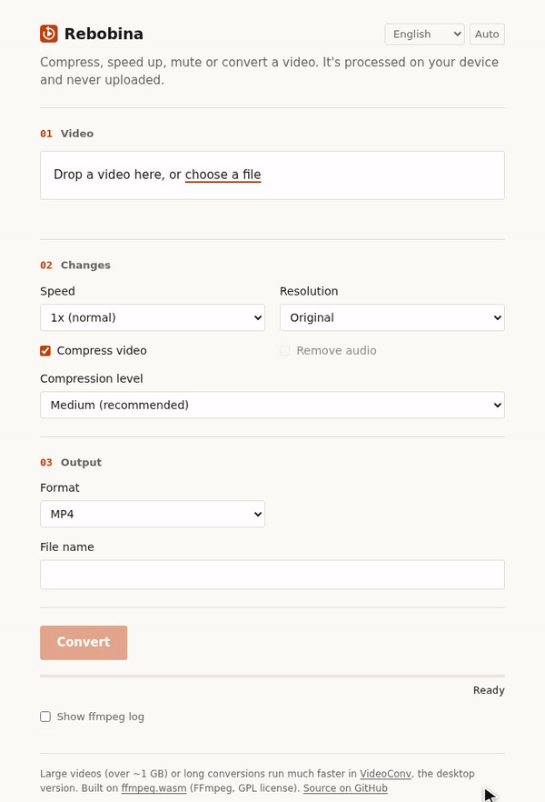

#  Rebobina

Compress, speed up, mute or convert a video in the browser. It's processed on your
device, so nothing gets uploaded and there's nothing to install.

**[Open Rebobina](https://leo-bonacini.github.io/rebobina/)** (English, Português, Español)

## How to use

1. Open the page and drop a video on the dashed area (or click it to pick a file).
2. Choose what to do: speed, resolution, compression, removing the audio.
3. Choose the output format. You can also change the file name.
4. Click **Convert**. When it's done, click **Download**.

The first time, the page downloads ffmpeg (about 30 MB). After that the browser keeps it cached.

## Features

- Compresses videos at 4 levels and lowers the resolution (1080p, 720p, 480p, 360p)
- Removes the audio
- Changes speed: 0.25x, 0.5x, 0.75x, 1.25x, 1.5x, 2x, 3x, 4x and 8x (audio follows along)
- Converts to MP4, MKV, WEBM, AVI, MOV or GIF
- Shows progress, time left and how much smaller the file got
- Interface in English, Portuguese and Spanish (picked from the browser language, can be changed at the top)
- Light and dark themes: follows the system by default, or pick one with the button at the top
- Usage counter at the bottom: how many people have used it and how many videos were converted

Accepts mp4, mkv, avi, mov, webm, flv, wmv, m4v, mpg, mpeg, 3gp, ts, mts, m2ts, ogv and gif.

Works in Chrome, Edge, Firefox and Safari, on desktop and mobile.

## Browser limits

Rebobina uses [ffmpeg.wasm](https://ffmpegwasm.netlify.app/), ffmpeg compiled to run inside
the page. Because of that:

- It's slower than a native ffmpeg, since it runs on a single CPU core.
- Videos over ~1 GB may run out of browser memory.
- It works on phones, but short videos are a better fit there.

## License

Rebobina's code is under the [MIT](LICENSE) license.
[ffmpeg.wasm](https://github.com/ffmpegwasm/ffmpeg.wasm) is MIT, and the FFmpeg it loads is GPL
(source code at https://ffmpeg.org/download.html).
